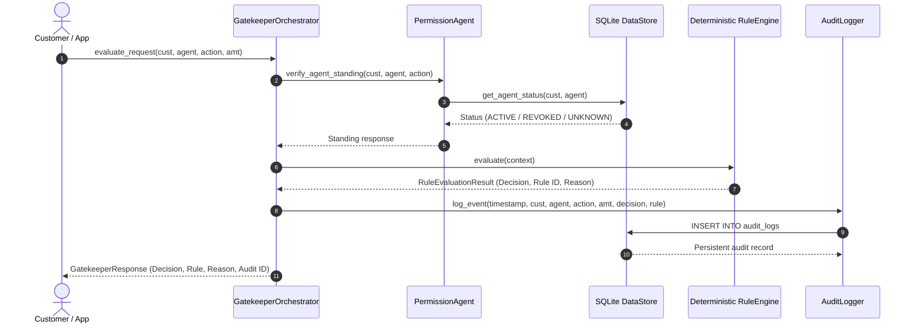

# AI Agent Gatekeeper for Banking Transactions

**Academic Coursework Prototype**  
**Student Enrolment Number:** `PGD202565745`  
**Assigned Business Domain:** Banking (Assigned based on enrolment ending digit `5`)  
**Selected Reference Institution:** Capital One (Background context only)

---

## 1. Project Purpose & Executive Summary

As autonomous personal AI agents (e.g., automated budgeting assistants, bill-paying bots, shopping concierges) become commonplace, consumers increasingly delegate access to their financial accounts. However, granting unconstrained transaction authority to autonomous software introduces severe operational, financial, and regulatory risks:

1. **Unauthorized / Excessive Transfers:** AI agents might misinterpret ambiguous instructions or suffer hallucinations.
2. **Account Takeover / Compromised Agents:** Malicious actors might prompt-inject or compromise an agent's delegated authority.
3. **Lack of Human Accountability:** Transactions executed without a customer confirmation checkpoint could lead to irreversible losses.

The **AI Agent Gatekeeper for Banking Transactions** is a policy control layer and risk mitigation firewall that sits between personal AI agents and bank account operations. It evaluates every agent-initiated action against deterministic safety rules and assigns one of three decisions:

- **ALLOW:** The action falls within safe risk bounds and can proceed automatically.
- **ASK CUSTOMER:** The action involves moderate or elevated risk (e.g., high amounts, sensitive money movement) and requires explicit two-factor customer authorization before execution.
- **BLOCK:** The action violates safety policies (e.g., unauthorized action, revoked agent standing, exceeded limits, customer rejection) and is halted immediately.

### Academic Disclaimer
> **Important:** This project is a student-designed policy prototype developed for MBA coursework. The business rules and risk thresholds implemented herein are designed strictly for academic and demonstration purposes. They are **NOT** official Capital One policies and this software is **NOT** an official Capital One system. Public information regarding modern banking practices serves merely as background context for the business problem. All customer data, balances, and transaction records are purely synthetic. No real banking operations or monetary movements are performed.

---

## 2. Prototype Banking Agent Rules

The prototype enforces eight student-designed deterministic rules to govern personal AI agent actions on customer accounts.

- **Student-Designed Policies:** These eight rules are student-designed for this assignment.
- **Academic Context:** They are NOT official Capital One policies.
- **Prototype Threshold:** Uses a **prototype automatic-payment threshold: $500** per transaction. This threshold was selected solely for coursework demonstration.
- **Governance Objective:** The purpose is to demonstrate a rigorous, traceable governance model for personal AI agents interacting with financial institutions.

### The 8 Deterministic Rules

| Rule ID | Rule Name | Condition | Decision | Risk Rationale / Reason |
|---|---|---|---|---|
| **R1** | Unknown Agent | The AI agent is not registered for the customer. | `BLOCK` | Unknown agents should not access the customer's banking account. |
| **R2** | Registered Read-Only Access | The agent is registered and active AND the action is View Balance. | `ALLOW` | Viewing the balance is read-only and has lower transaction risk. |
| **R3** | Low-Value Bill Payment | The agent is registered and active AND the action is Pay Bill AND amount <= $500. | `ALLOW` | Routine lower-value bill payments can be automated within the prototype threshold. |
| **R4** | High-Value Bill Payment | The agent is registered and active AND the action is Pay Bill AND amount > $500. | `ASK CUSTOMER` | A payment above the prototype automatic-payment threshold requires customer confirmation. |
| **R5** | Low-Value Money Transfer | The agent is registered and active AND the action is Transfer Money AND amount <= $500. | `ASK CUSTOMER` | Money transfers are more sensitive than read-only access or routine bill payments, so customer confirmation is required even below the threshold. |
| **R6** | High-Value Money Transfer | The agent is registered and active AND the action is Transfer Money AND amount > $500. | `BLOCK` | A high-value money transfer presents greater fraud and liability risk in this prototype. |
| **R7** | Revoked Agent | The agent has been revoked. | `BLOCK` | Customer revocation must immediately override other permissions. Checked before action rules. |
| **R8** | Customer Rejection | The customer explicitly rejects/denies the current request. | `BLOCK` | The customer's explicit decision overrides the AI agent's permission. Ultimate priority. |

### Decision Priority Order
Rule evaluation occurs in a strict, predictable order:
1. **R8 — Customer Rejection:** Explicit customer rejection immediately blocks the transaction.
2. **R7 — Agent Revocation:** Revoked agents are blocked immediately; a revoked agent never receives `ALLOW` or `ASK CUSTOMER`.
3. **R1 — Agent Unknown/Unregistered:** Unknown agents are halted before evaluating action types.
4. **R2 — View Balance:** Read-only access is permitted for active registered agents.
5. **R3 / R4 — Pay Bill:** Evaluated against the prototype automatic-payment threshold of $500.
6. **R5 / R6 — Transfer Money:** Sensitive transfers require step-up confirmation (`<= $500`) or are blocked (`> $500`).

### Decision Matrix

| Agent Status | Action | Amount | Customer State | Decision | Triggered Rule |
|---|---|---|---|---|---|
| Any | Any supported action | Any | Rejected | `BLOCK` | **R8** |
| Revoked | Any action | Any | Any | `BLOCK` | **R7** |
| Unknown | Any action | Any | Any | `BLOCK` | **R1** |
| Active | View Balance | Any | Normal | `ALLOW` | **R2** |
| Active | Pay Bill | <= $500 | Normal | `ALLOW` | **R3** |
| Active | Pay Bill | > $500 | Normal | `ASK CUSTOMER` | **R4** |
| Active | Transfer Money | <= $500 | Normal | `ASK CUSTOMER` | **R5** |
| Active | Transfer Money | > $500 | Normal | `BLOCK` | **R6** |

---

## 3. Stage 3 — Agent Lifecycle and Audit Trail

Stage 3 provides the operational backend and persistence mechanisms connecting agent lifecycle management, credential verification, policy evaluation, and audit governance.

### How Agents Are Registered
Customers onboard authorized AI agents via the `RegistrationAgent`. When registered, the agent is assigned an `ACTIVE` status and an immutable, system-generated UTC registration timestamp is persisted in the local SQLite database (`agents` table).

### How Agents Are Revoked
Customers can revoke an AI agent at any time through the `RevocationAgent`. Revocation updates the agent's standing to `REVOKED`, captures the current system UTC revocation timestamp, and appends the revocation rationale.

### How Revocation Persists
Agent state is stored persistently in SQLite (`data/gatekeeper.db`). When an agent is marked `REVOKED`, the state is permanently saved to disk. When the program stops and restarts, the revoked state remains intact. A revoked agent cannot automatically become active again, guaranteeing that compromised agents remain neutralized across restarts.

### How Requests Move Through the Orchestrator
The `GatekeeperOrchestrator` coordinates the end-to-end transaction pipeline:


1. **Request Intake:** Validates customer ID, agent name, supported action, and non-negative amount.
2. **Permission Check:** `PermissionAgent` queries `DataStore` to determine if the agent is `ACTIVE`, `REVOKED`, or `UNKNOWN`.
3. **Deterministic Evaluation:** `RuleEngine` evaluates context against the priority hierarchy (R8 $\rightarrow$ R7 $\rightarrow$ R1 $\rightarrow$ R2 $\rightarrow$ R3/R4 $\rightarrow$ R5/R6).
4. **Audit Logging:** Every evaluated transaction creates an append-only audit record in `audit_logs`.
5. **Structured Response:** Returns `decision`, `rule_id`, `reason`, `timestamp`, `amount`, and `audit_id`.

---

## 4. Stage 4 — Coursework Scenario Verification

Stage 4 validates the gatekeeper pipeline against the **six mandatory coursework scenarios** required for the MBA assignment. It ensures deterministic decisions, accurate rule attribution, test isolation, and full audit persistence across all operational conditions.

### The Six Mandatory Coursework Scenarios

| Scenario | Customer | Agent | Action | Amount | Expected Decision | Expected Rule | Business Rationale |
|:---:|:---:|:---:|:---:|:---:|:---:|:---:|---|
| **1** | CUST001 | BankBot (Active) | View Balance | $0.00 | `ALLOW` | **R2** | A registered active agent may perform a read-only balance inquiry with low transaction risk. |
| **2** | CUST001 | RandomAI (Unknown) | View Balance | $0.00 | `BLOCK` | **R1** | An agent that is not registered for the customer must not access the banking account. |
| **3** | CUST002 | PayPilot (Active) | Pay Bill | $800.00 | `ASK CUSTOMER` | **R4** | Payment above the $500 prototype automatic-payment threshold requires customer confirmation. |
| **4** | CUST002 | PayPilot (Active) | Pay Bill | $300.00 | `ALLOW` | **R3** | Routine bill payments up to and including the $500 threshold may be automated. |
| **5** | CUST001 | BankBot (Revoked) | Pay Bill | $100.00 | `BLOCK` | **R7** | A revoked agent must always be blocked, regardless of the transaction amount. |
| **6** | CUST002 | PayPilot (Active) | Transfer Money | $400.00 | `ASK CUSTOMER` | **R5** | Money transfers are more sensitive than bill payments and require confirmation even below $500. |

### Expected vs Actual Verification Table

Results executed deterministically through [services/scenario_runner.py](file:///c:/Users/Administrator/Desktop/ai/mba_ai_agent_gatekeeper/services/scenario_runner.py):

| Scenario | Expected Decision | Actual Decision | Expected Rule | Actual Rule | Audit | Result |
|:--------:|:-----------------:|:---------------:|:-------------:|:-----------:|:-----:|:------:|
| Scenario 1 | ALLOW | ALLOW | R2 | R2 | PASS | **PASS** |
| Scenario 2 | BLOCK | BLOCK | R1 | R1 | PASS | **PASS** |
| Scenario 3 | ASK CUSTOMER | ASK CUSTOMER | R4 | R4 | PASS | **PASS** |
| Scenario 4 | ALLOW | ALLOW | R3 | R3 | PASS | **PASS** |
| Scenario 5 | BLOCK | BLOCK | R7 | R7 | PASS | **PASS** |
| Scenario 6 | ASK CUSTOMER | ASK CUSTOMER | R5 | R5 | PASS | **PASS** |

---

## 5. Stage 5 — Interactive Streamlit Dashboard

Stage 5 provides a functional, user-friendly web interface in [app.py](file:///c:/Users/Administrator/Desktop/ai/mba_ai_agent_gatekeeper/app.py) designed for demonstration and screen recording. It directly consumes backend services without duplicating any business rules.

### Dashboard Sections
1. **Hero & Student Header:** Prominently displays Student Enrolment Number `PGD202565745`, Assigned Domain (`Banking`), and the mandatory Academic Context Disclosure banner.
2. **Evaluate Request:** Interactive form to submit customer ID, agent name, action, amount, and customer override rejection flag. Prominently displays the decision (`ALLOW`, `ASK CUSTOMER`, `BLOCK`), triggered rule ID, and reason.
3. **Agent Registration:** Direct interface to enroll new agents with real system UTC timestamps and persistent `ACTIVE` status.
4. **Revoke Agent:** Decommission agents with immediate permanent enforcement and confirmation messages.
5. **Agent Status:** Real-time query inspecting SQLite standing (`ACTIVE`, `REVOKED`, `UNKNOWN`) and timestamp history.
6. **Coursework Verification:** One-click runner executing all 6 coursework scenarios through `CourseworkScenarioRunner` and displaying the live Expected vs Actual comparison table.
7. **Audit Trail:** Dynamic view of the persistent SQLite `audit_logs` table with customer filtering and refresh controls.

### Launching the Dashboard
```bash
streamlit run app.py
```
*Accessible locally at: `http://localhost:8501`*

---

## 6. Project Architecture

The architecture enforces clean separation of concerns:

```
mba_ai_agent_gatekeeper/
│
├── app.py                     # Streamlit frontend dashboard (displays enrolment PGD202565745)
├── orchestrator.py            # Central coordinator connecting agents & services
│
├── agents/                    # Specialized agent modules (Agentic role separation)
│   ├── __init__.py
│   ├── registration_agent.py  # Agent onboarding and metadata validation
│   ├── permission_agent.py    # Agent standing and credential verification
│   ├── decision_agent.py      # Synthesizes inputs into gatekeeper decisions
│   ├── revocation_agent.py    # Decommissions agents & enforces permanent blocks
│   └── audit_agent.py         # Enforces compliance logging and audit traceability
│
├── services/                  # Deterministic backend services
│   ├── __init__.py
│   ├── data_store.py          # Persistent SQLite data store (agents, audit_logs, accounts)
│   ├── rule_engine.py         # Deterministic policy rules evaluation (R1 - R8)
│   └── audit_logger.py        # Append-only persistent audit trail logger
│   └── scenario_runner.py     # Coursework scenario runner and audit verification harness
│
├── data/                      # Local synthetic storage (demo data only)
│   ├── gatekeeper.db          # SQLite persistent database (created automatically)
│   └── README.md
│
├── tests/                     # Automated testing suite
│   ├── __init__.py
│   ├── test_structure.py      # Architecture and import sanity tests
│   ├── test_rule_engine.py    # Unit, boundary, and priority tests for R1-R8
│   ├── test_stage3_pipeline.py # End-to-end pipeline, persistence, and audit tests
│   ├── test_coursework_scenarios.py # Pytest validation for the 6 coursework scenarios
│   └── test_app_smoke.py      # Streamlit dashboard smoke & initialization tests
│
├── PROMPTS.md                 # Development prompt and design log
├── requirements.txt           # Minimal justified dependencies (Streamlit, Pydantic, Pytest)
├── .gitignore                 # Standard Python/Streamlit exclusions
└── README.md                  # Project documentation & architecture guide
```

---

## 7. Development Stages

| Stage | Focus Area | Status | Deliverables |
|---|---|---|---|
| **Stage 1** | Architecture Scaffolding & Setup | **COMPLETED** | Folder structure, modular skeletons, initial tests, README, PROMPTS.md, requirements.txt, .gitignore. |
| **Stage 2** | Deterministic Policy & Rule Engine | **COMPLETED** | 8 deterministic rules (R1-R8), prototype threshold ($500), decision matrix, Pydantic models, unit test suite (19 tests). |
| **Stage 3** | Agent Lifecycle, Persistence & Pipeline | **COMPLETED** | SQLite persistence, RegistrationAgent, RevocationAgent, PermissionAgent, AuditLogger, Orchestrator pipeline, 33 automated tests. |
| **Stage 4** | Six Coursework Scenarios & Verification Suite | **COMPLETED** | 6 mandatory scenarios implemented, scenario runner with audit verification, expected vs actual table, 40 automated tests. |
| **Stage 5** | Streamlit Interactive Dashboard | **COMPLETED** | Web dashboard in `app.py`, live transaction evaluation, agent registration/revocation, audit viewer, scenario table, 42 automated tests. |

---

## 8. Setup and Verification Instructions

### Prerequisites
- Python 3.10+ (Current runtime: Python 3.14.6)
- Standard environment or Anaconda

### Installation
```bash
# Navigate to project directory
cd mba_ai_agent_gatekeeper

# Install minimal dependencies
pip install -r requirements.txt
```

### Running the Test Suite
```bash
pytest tests/ -v
```

All 42 automated tests (including structural sanity tests, rule engine tests for R1-R8, boundaries, priorities, Stage 3 lifecycle/persistence tests, Stage 4 coursework scenario tests, and Stage 5 app smoke tests) run locally and deterministically.

---

## 9. How to Demonstrate the Prototype

This section provides a step-by-step walkthrough for demonstrating the prototype during screen recording or live presentation.

### Step 1 — Start the Streamlit Application

```bash
streamlit run app.py
```

The dashboard opens automatically at `http://localhost:8501`. The main screen displays:
- Student Enrolment Number: **PGD202565745**
- Assigned Business Domain: **Banking**
- Reference Institution: **Capital One** (background context only)
- Academic prototype disclaimer

---

### Step 2 — Register an AI Agent

1. Click the **"Agent Registration"** tab.
2. Enter a **Customer ID** (e.g., `CUST001`) and an **Agent Name** (e.g., `BankBot`).
3. Click **Register Agent**.
4. Confirm the confirmation message shows `ACTIVE` status and a UTC registration timestamp.

> The agent is now persisted in `data/gatekeeper.db` and will remain registered across application restarts.

---

### Step 3 — Evaluate a Request

1. Click the **"Evaluate Request"** tab.
2. Fill in the form:
   - **Customer ID:** `CUST001`
   - **Agent Name:** `BankBot`
   - **Action:** `View Balance`
   - **Amount:** `0.00`
   - Leave **Customer Rejection** unchecked
3. Click **Evaluate**.
4. The response displays:
   - **Decision:** `ALLOW`
   - **Rule:** `R2`
   - **Reason:** explaining the deterministic rule applied

Try different combinations (e.g., `Transfer Money` / `$600.00`) to observe `BLOCK` (R6) or `ASK CUSTOMER` (R5) outcomes.

---

### Step 4 — Revoke an Agent

1. Click the **"Revoke Agent"** tab.
2. Enter the same **Customer ID** (`CUST001`) and **Agent Name** (`BankBot`).
3. Click **Revoke Agent**.
4. Confirm the message shows `REVOKED` status with a UTC revocation timestamp.

After revocation, return to **Evaluate Request** and submit any action for `BankBot` — the decision will be `BLOCK` / Rule `R7`, regardless of action type or amount.

---

### Step 5 — Check the Audit Trail

1. Click the **"Audit Trail"** tab.
2. All evaluated requests are listed with:
   - Date/time (UTC)
   - Customer ID and Agent name
   - Action and amount
   - Decision and triggered Rule ID
3. Optionally filter by **Customer ID** to narrow results.
4. Click **Refresh** to reload the latest entries.

> All audit records are append-only and are persisted in `data/gatekeeper.db`.

---

### Step 6 — Run the Six Coursework Verification Scenarios

#### Via the Dashboard (recommended for screen recording)

1. Click the **"Coursework Verification"** tab.
2. Click **Run All 6 Scenarios**.
3. The Expected vs Actual table is displayed immediately, showing:
   - Scenario number and description
   - Expected Decision and Rule
   - Actual Decision and Rule
   - Audit verification result
   - Overall PASS / FAIL per scenario

#### Via the command line

```bash
python services/scenario_runner.py
```

This runs all six scenarios against an isolated temporary database and prints the full Expected vs Actual comparison to the terminal.

---

### Step 7 — Run the Full Automated Test Suite

```bash
pytest tests/ -v
```

Expected result:
```
42 passed, 0 failed, 0 errors
```

The suite covers:
| Test File | Coverage |
|---|---|
| `tests/test_structure.py` | Architecture and import sanity (4 tests) |
| `tests/test_rule_engine.py` | Rule engine R1-R8, boundaries, priority (15 tests) |
| `tests/test_stage3_pipeline.py` | Agent lifecycle, persistence, audit pipeline (18 tests) |
| `tests/test_coursework_scenarios.py` | All 6 mandatory coursework scenarios (7 tests) |
| `tests/test_app_smoke.py` | Streamlit dashboard smoke tests (2 tests) |
